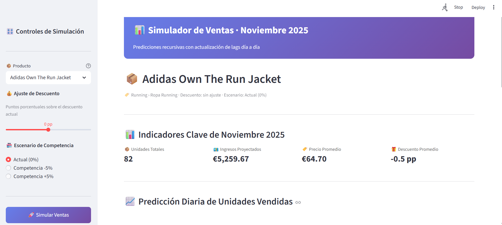

# Forecasting de Ventas · Noviembre 2025

> **Data Science accesible:** un proyecto completo de predicción de ventas, desde los datos crudos hasta una app interactiva, construido con **Claude Code** como asistente de IA principal.

**Para abrir la app** hay que activar el entorno de conda `forecastingventas` y ejecutar `streamlit run app/streamlit_app.py` en la consola, desde la carpeta del proyecto (ver [Cómo abrir la app](#cómo-abrir-la-app)).



---

## La idea detrás del proyecto

Hace unos años, un proyecto así exigía dominar Python, pandas, scikit-learn, visualización y desarrollo web. Hoy, con asistentes de IA como **Claude Code**, el foco cambia:

- **El valor está en entender el problema**: qué preguntas hace negocio, qué variables importan, cómo validar que un modelo sirve.
- **La IA acelera la parte técnica**: escribir código, depurar errores o montar la interfaz.
- **El criterio sigue siendo humano**: decidir qué features crear, detectar un resultado que no tiene sentido o elegir cómo presentar los resultados.

Este repositorio demuestra que **no hace falta ser el mejor programador para hacer data science de calidad**. Hace falta pensamiento analítico, curiosidad y saber trabajar *con* la IA.

---

## Objetivo de negocio

Predecir las **unidades vendidas por día** de 24 productos durante noviembre de 2025, incluido el **Black Friday**, y permitir **simular escenarios**:

- ¿Qué pasa si aplico más (o menos) descuento?
- ¿Y si la competencia sube o baja sus precios un 5 %?

---

## Enfoque técnico

| Fase | Qué se hizo |
|---|---|
| **Datos** | Limpieza y unión de históricos de ventas y precios de la competencia |
| **Feature engineering** | Lags de 1 a 7 días, media móvil de 7 días, variables de calendario, ratio entre precio propio y de la competencia, descuento |
| **Modelo** | `HistGradientBoostingRegressor` (scikit-learn) |
| **Validación** | <!-- Completa: p. ej. split temporal, MAE = X, RMSE = Y --> |
| **Predicción** | **Recursiva**: cada predicción diaria alimenta los lags del día siguiente |
| **Producto final** | App interactiva en **Streamlit** con KPIs, gráfico diario, tabla de detalle y comparativa de escenarios |

---

## La aplicación

- Selección de producto, ajuste del descuento y escenario de competencia
- KPIs: unidades, ingresos, precio medio y descuento medio
- Predicción diaria con el Black Friday destacado
- Comparativa de los tres escenarios de competencia

---

## Cómo se usó Claude Code

Claude Code fue el **compañero de programación** durante todo el proyecto:

- Generar y refactorizar el código de los notebooks y de la app
- Depurar errores (por ejemplo, el ciclo de vida de `st.session_state` en Streamlit)
- Diseñar la lógica de predicción recursiva con actualización de lags
- Revisar el código en busca de bugs de lógica de negocio

Mi papel: **definir el problema, tomar las decisiones de modelado, validar los resultados y dirigir a la IA**. El archivo [`CLAUDE.md`](CLAUDE.md) contiene el contexto que usé para guiar al asistente.

---

## Estructura

```
DATA_SCIENCE_ACTUALIDAD_CODEMARKETERS/
├── app/
│   └── streamlit_app.py          # Simulador interactivo
├── data/
│   ├── raw/                      # Datos originales
│   └── processed/                # Datos de entrenamiento e inferencia
├── models/
│   └── modelo_final.joblib       # Modelo entrenado (scikit-learn 1.8.0)
├── notebooks/
│   ├── entrenamiento.ipynb       # EDA, features y entrenamiento
│   └── forecasting.ipynb         # Preparación de inferencia
├── docs/
├── CLAUDE.md                     # Contexto para Claude Code
└── requirements.txt
```

---

## Cómo abrir la app

### 1. Clonar el repositorio

```bash
git clone https://github.com/PedroALOhub/DATA_SCIENCE_ACTUALIDAD_CODEMARKETERS.git
cd DATA_SCIENCE_ACTUALIDAD_CODEMARKETERS
```

### 2. Crear y activar el entorno `forecastingventas`

El proyecto usa un entorno de conda propio llamado **`forecastingventas`**, con las versiones de las librerías con las que se entrenó el modelo. Si se usa otro entorno (por ejemplo `base`), el modelo `.joblib` puede no cargar por diferencias de versión de scikit-learn.

```bash
conda create -n forecastingventas python=3.11 -y
conda activate forecastingventas
pip install -r requirements.txt
```

Antes de continuar, comprueba que la consola muestra `(forecastingventas)` al principio de la línea y no `(base)`:

```
(forecastingventas) PS C:\...\DATA_SCIENCE_ACTUALIDAD_CODEMARKETERS>
```

> Cada vez que abras una consola nueva tendrás que volver a ejecutar `conda activate forecastingventas`. La instalación (`conda create` y `pip install`) solo se hace la primera vez.

### 3. Lanzar la app

Desde la carpeta raíz del proyecto y con el entorno activado:

```bash
streamlit run app/streamlit_app.py
```

La app no está publicada en ningún servidor: se ejecuta en local con Streamlit. Al lanzar el último comando se abre automáticamente en el navegador, en `http://localhost:8501`.

> **Importante:** hay que arrancarla con `streamlit run` desde la raíz del proyecto. Si se ejecuta con `python app/streamlit_app.py` (o con el botón "Run Python File" de VS Code), la app no funciona, porque Streamlit necesita su propio servidor para gestionar el estado de la sesión.

---

## Aprendizajes

- La predicción recursiva acumula error día a día, así que validar a un solo día no basta.
- Las features de precio relativo (propio frente a competencia) son clave para simular escenarios.
- Trabajar con IA exige **saber qué pedir y comprobar lo que devuelve**: el criterio sigue siendo lo más valioso.

---

## Autor

**Pedro Antonio Laria**
<!-- Añade tu LinkedIn -->
[GitHub](https://github.com/PedroALOhub)
